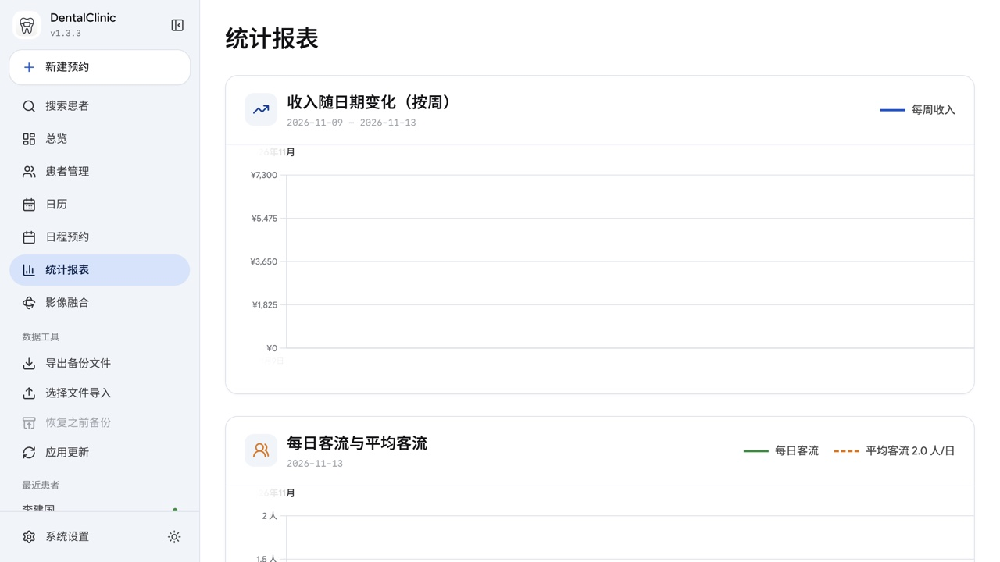
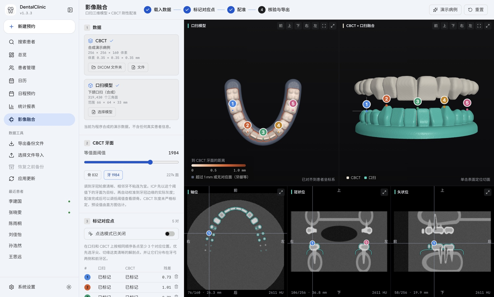
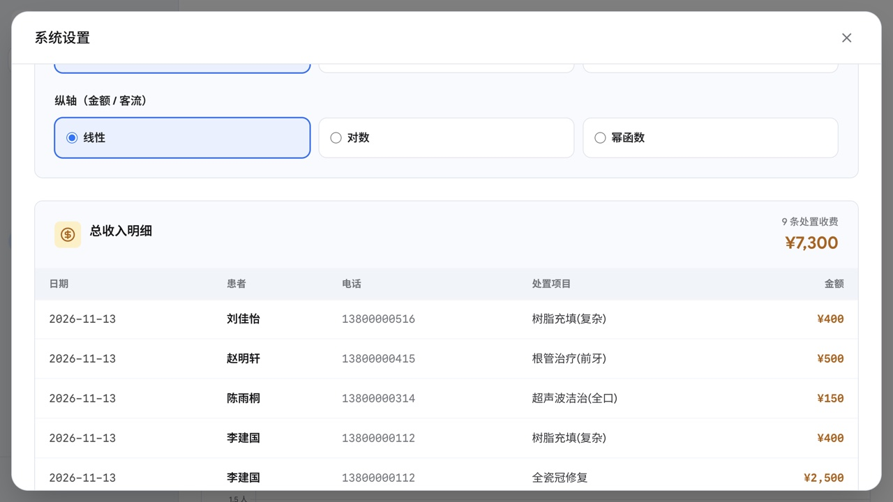
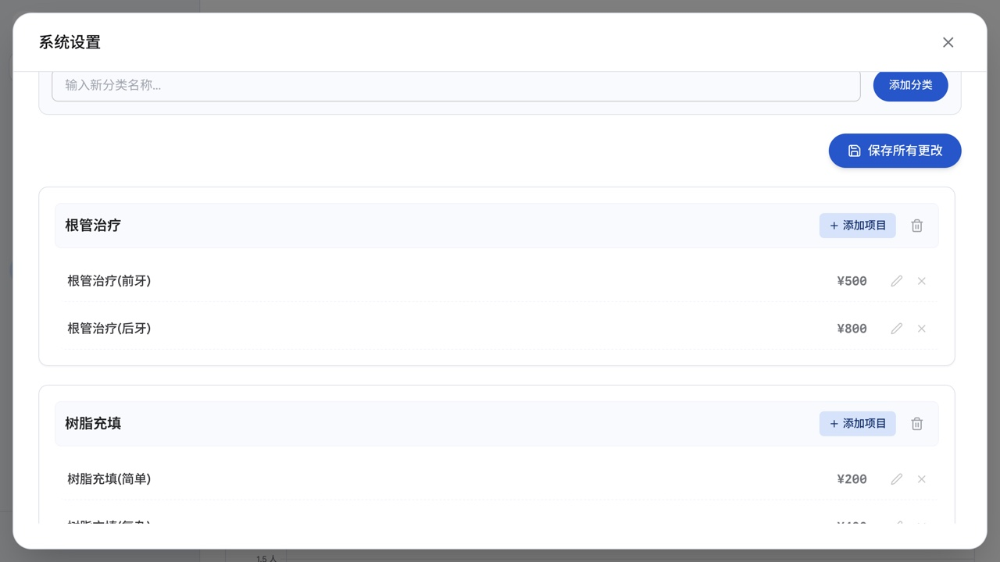

<p align="center">
  
</p>

<h1 align="center">DentalClinic 口腔诊所管理系统</h1>

<p align="center">
  患者、接诊、处置、预约、统计与备份集中管理的本地桌面应用
</p>

<p align="center">
  <strong>当前版本：v1.3.3</strong> · Windows / macOS / Linux · AGPL-3.0-only
</p>

DentalClinic 面向小型口腔诊所，日常使用不依赖云端账号。正式安装版以 **DentalSystem** 作为安装包名称，应用内默认显示 **DentalClinic**；诊所名称可在设置中修改。

> [!IMPORTANT]
> 正式安装版使用 Electron 用户数据目录中的 SQLite 保存业务数据，并通过系统安全存储加密敏感内容。`npm run dev` 是独立的浏览器预览环境，使用浏览器本地存储，不会与正式安装版自动共用数据。


## 目录

- [快速开始](#快速开始)
- [核心功能](#核心功能)
- [统计报表](#统计报表)
- [影像融合](#影像融合)
- [侧边栏数据工具](#侧边栏数据工具)
- [界面与主题](#界面与主题)
- [系统设置使用指南](#系统设置使用指南)
- [备份、迁移与恢复](#备份迁移与恢复)
- [可选的云端备份](#可选的云端备份)
- [安装与升级](#安装与升级)
- [开发与构建](#开发与构建)
- [数据安全与许可](#数据安全与许可)

## 快速开始

首次打开后，建议按下面的顺序完成初始化：

1. 打开左侧栏底部的 **系统设置**，在“通用与数据”中填写诊所名称。
2. 进入“处置项目管理”，核对分类、项目名称和默认价格。
3. 新增一位测试患者，尝试初诊、复诊、预约和处置录入。
4. 检查统计报表是否符合诊所的查看习惯。
5. 删除测试数据后，从侧边栏点击 **导出备份文件**，保存第一份 JSON 备份。

## 核心功能

### 患者管理

患者库支持姓名、电话、全拼和拼音首字母搜索，并可在“全部 / 近七天”之间切换。


- 新增、编辑和删除患者档案。
- 区分初诊与复诊，并在列表中显示今日接诊状态。
- 对相似姓名和相同电话号码给出提示，减少重复建档。
- 患者详情包含基本信息、处置记录和预约历史。
- 处置可记录项目、价格、牙位和备注；修改后保留变更日志。

### 患者日历

日历按月汇总建档、初诊、复诊、预约和处置活动。日期角标表示当天涉及的患者数量，右侧显示所选日期的详细记录。


- 支持上月、下月和回到今天。
- 可按患者姓名、拼音或电话过滤活动。
- 按住 `Command`（macOS）或 `Ctrl`（Windows / Linux）可叠加选择多个日期。
- 点击活动中的患者可直接进入患者详情。

### 日程预约

周视图以 30 分钟为单位展示预约，并支持同一时段的重叠预约。


- 创建预约时可设置日期、时间、时长、初复诊类型和计划处置。
- 支持待到诊、已到诊、已完成和已取消等状态。
- 可按患者、电话或处置项目搜索。
- 可编辑、取消或永久删除预约；已删除预约会保留同步标记，降低旧设备重新上传后恢复旧记录的风险。

### 接诊与处置

- 新建患者时可选择“仅保存档案”或“保存并接诊”。
- 患者详情中的“标记复诊”会新增当天复诊记录。
- 预约中的计划处置可以在完成预约时转为正式处置，避免重复录入。
- 历史处置保存当时的项目名称和成交价，之后修改目录不会回写历史记录。

## 统计报表

统计页由两张带填色的折线图组成：收入按自然周汇总，客流保留每日粒度，月份作为大分区。线下区域采用约 **80% 透明度**；两张图底部始终提供可拖动的横向滚动条，默认定位到最新数据。



### 收入随日期变化（按周）

- 每条处置记录的价格进入总收入。
- 日期有效且位于图表范围内的处置会按自然周汇总，每周范围为周一至周日；当前周只统计到今天。
- 日期无效、未来日期或超出范围的记录仍保留在总收入明细中，但会标记为“未纳入折线”。

### 每日客流与平均客流

- 客流只统计 **初诊添加** 和 **复诊添加**。
- 同一患者在同一自然日只计一次；若同日同时存在初诊和复诊，则优先计入初诊。
- 平均客流以橙色虚线显示，计算方式为图表日期区间总客流除以区间自然日数，包含零客流日。

横轴、纵轴的线性 / 对数 / 幂函数关系可在 **系统设置 → 统计与收入** 中修改。

## 影像融合

载入 CBCT 和口扫模型，点几对对应点后自动精配准，在三维视图和三个切面上核验口扫牙冠与 CBCT 是否贴合。图中为程序合成的演示病例。



- 读取未压缩的 DICOM 序列或 NIfTI 体数据，以及 STL / PLY / OBJ 口扫模型；也可以先载入内置的合成演示病例熟悉流程。
- 在口扫和 CBCT 上按相同顺序点选至少 3 对标记点完成粗配准，再由修剪式 ICP 和牙面阈值自校准完成精配准，计算在后台线程进行。
- 用表面偏差热力图和轴位、冠状位、矢状位切面上的口扫轮廓核验结果，可导出配准矩阵 JSON 和已变换到 DICOM 患者坐标系的 STL。
- 影像只在本机内存中处理，不写入诊所数据库，也不随云端备份上传。配准结果用于辅助阅片，不是医疗器械，需由医生核验。

方法、所用开源项目、自测结果与已知局限见 [docs/imaging-fusion.md](docs/imaging-fusion.md)。

## 侧边栏数据工具

四个常用维护操作固定在侧边栏“数据工具”区域，无需再进入设置页。

| 按钮 | 用途 | 注意事项 |
| --- | --- | --- |
| 导出备份文件 | 将当前完整数据导出为 JSON | 不修改本机数据 |
| 选择文件导入 | 校验备份并显示新增、覆盖、移除差异 | 确认后会整体覆盖本机主数据 |
| 恢复之前备份 | 恢复最近一次导入前自动保存的备份 | 无可用备份时按钮禁用 |
| 应用更新 | 检查新版本；有新版时打开 Release | 普通结果提示会在 3 秒后自动消失 |

侧边栏可以收起；收起后四项操作仍以图标按钮保留，并提供悬停说明。

## 界面与主题

- 侧栏底部右侧的按钮在浅色和深色界面之间切换；没有手动切换过时，取启动时的系统外观。主题是本机的显示偏好，不写入诊所数据，也不参与云端同步。
- 总览页的搜索框支持按姓名、电话或拼音首字母查找患者，按 `⌘K`（Windows / Linux 为 `Ctrl K`）可以从其他页面跳到这里；有弹窗打开或患者资料正在编辑时不会跳转，以免丢失未保存的内容。
- macOS 下窗口不显示系统标题栏，红绿灯嵌在侧栏左上角；侧栏顶部和主区域最上方的窄边可以拖动窗口。
- 界面字体为随应用打包的 Google Sans Flex、Noto Sans SC 和 Google Sans Code（均为 SIL Open Font License 1.1，许可文本在 `public/font-licenses/`），不需要联网加载。配色集中定义在 `theme.css`。

## 系统设置使用指南

点击左侧栏底部的 **系统设置**。设置弹窗包含三个页签：

1. 通用与数据
2. 统计与收入
3. 处置项目管理

### 1. 通用与数据


#### 云端数据

1. **云端服务地址**：填写 Worker 根地址，例如 `https://your-worker.workers.dev`。
2. **访问密钥**：填写与服务器 `BACKUP_TOKEN` 完全相同的密钥。
3. **上传备份**：把当前完整快照加密后上传到云端，并保留历史版本。
4. **云端同步**：拉取云端最新快照并覆盖本机数据。

地址末尾无需手动填写 `/backup` 或 `/sync`。点击“上传备份”或“云端同步”时，应用会校验并保存当前地址与密钥。

> [!WARNING]
> 云端同步会覆盖本机数据。同步前请先使用侧边栏的“导出备份文件”保存独立副本。访问密钥同时用于鉴权和解密，遗失后无法恢复已有云端密文。

#### 诊所名称

在“诊所名称”输入框中填写名称并点击 **保存名称**。保存后，侧边栏标题和后续导出的备份都会使用新名称。

### 2. 统计与收入

坐标关系设置会立即应用并保存在本机，无需额外点击保存；收入图和客流图共用同一组设置。


| 坐标关系 | 显示效果 | 适合场景 |
| --- | --- | --- |
| 线性 | 保持均匀日期间距和原始数值比例 | 日常查看，默认选项 |
| 对数 | 压缩较大数值或较远日期之间的视觉差距，零值仍可显示 | 金额或客流跨度较大 |
| 幂函数 | 根据指数强化或压缩差距 | 需要突出峰值或调整日期点间距 |

任一坐标轴选择幂函数后，会出现 **幂函数指数** 滑杆：

- 范围：`0.1–5.0`
- 步长：`0.1`
- 默认值：`2.0`
- 横轴和纵轴共用同一个指数

这些选项只改变可视化映射，不会修改收入、客流或日期原始数据。

#### 总收入明细



该区域为只读列表，显示：

- 处置收费条数与总收入。
- 日期、患者、电话、处置项目和金额。
- 按日期及创建时间从新到旧排列的收费记录。
- 未进入折线图范围的异常或超范围日期标记。

因此，总收入可能与当前折线图可见区间的金额合计不同。

### 3. 处置项目管理



1. 在顶部输入分类名，点击 **添加分类**。
2. 在分类右侧点击 **添加项目**，填写项目名称和默认价格。
3. 点击项目右侧的铅笔编辑名称或价格，以绿色对勾确认。
4. 点击项目右侧的 `×` 删除项目；点击分类右侧垃圾桶删除整个分类。
5. 完成全部调整后，必须点击 **保存所有更改**。

> [!IMPORTANT]
> 分类和项目的增删改会先保存在弹窗临时状态中。未点击“保存所有更改”就关闭设置，修改不会写入。目录只影响后续处置和预约计划的默认项目与价格，不会修改历史处置。

## 备份、迁移与恢复

### 日常备份

1. 点击侧边栏 **导出备份文件**。
2. 将生成的 `dental_clinic_backup_YYYY-MM-DD.json` 保存到安全位置。
3. 定期把副本复制到另一块磁盘或受控的加密存储。

### 换机或导入

1. 在新设备安装相同或更高版本。
2. 点击侧边栏 **选择文件导入**。
3. 查看患者、预约、处置和目录的新增 / 覆盖 / 移除预览。
4. 确认无误后执行覆盖导入。

应用在确认导入前会自动保存一份“导入前备份”。如果需要回退，可点击 **恢复之前备份**；恢复同样会覆盖当前主数据，因此操作前仍建议额外导出 JSON。

## 可选的云端备份

DentalClinic 可以接入 Cloudflare Worker + R2。数据会在应用端使用访问密钥加密，Worker 和 R2 保存的是密文。

推荐顺序：

```text
开始工作：云端同步 → 核对数据 → 开始录入
结束工作：导出本地 JSON → 上传备份
```

云端功能是完整快照同步，不是多人实时协作。多设备轮流使用时，后一台开始工作前必须先同步，前一台结束工作后必须先上传。

完整的 Worker、R2、密钥和故障排查步骤见：[Cloudflare 加密备份与同步](docs/cloud-backup.md)。

## 安装与升级

从 [GitHub Releases](https://github.com/SlxBYR/fkDental/releases) 下载对应平台的安装包。

| 平台 | v1.3.3 安装包 | 安装方法 |
| --- | --- | --- |
| Windows 10/11 64 位 | `DentalSystem Setup 1.3.3.exe` | 双击安装程序，从开始菜单启动 |
| macOS Apple Silicon | `DentalSystem-1.3.3-arm64.dmg` | 打开 DMG，拖入“应用程序” |
| macOS Intel | `DentalSystem-1.3.3-x64.dmg` | 打开 DMG，拖入“应用程序” |
| Debian / Ubuntu 64 位 | `DentalSystem-1.3.3-amd64.deb` | 使用软件安装器或 `apt` 安装 |

Electron 桌面安装包不能直接安装到 Android。

### macOS 首次打开

若安装包尚未使用 Apple Developer ID 签名和公证，macOS 可能提示无法验证开发者。可在 Finder 的“应用程序”中右键 DentalSystem，选择“打开”，再在确认窗口中继续。

### 升级与卸载

- 升级前先导出 JSON，退出 DentalSystem 后再运行新版本安装包。
- 覆盖安装默认保留用户数据；升级后仍应核对患者、预约和处置数量。
- Windows 正常卸载请使用“设置 → 应用 → 已安装的应用”，卸载器默认保留本地数据。
- Windows 安装目录提供 `resources/maintenance/DentalSystem-Uninstall-Helper.cmd`。选择 `D` 删除数据不可恢复，必须先导出备份。

## 开发与构建

本机需安装 Node.js 与 npm。

```bash
npm install
npm run dev
```

启动 Electron 开发环境：

```bash
npm run electron
```

生成前端生产构建：

```bash
npm run build
```

打包脚本：

```bash
npm run package
npm run package:windows
npm run package:macos
npm run package:macos:intel
npm run package:linux
```

各平台安装包应在对应平台或支持的交叉构建环境中生成。

## 贡献者与致谢

- **OpenAI Codex** — 项目作者与维护者
- **我** — 写prompt协助AI

## 数据安全与许可

- 正式安装版使用 SQLite 保存数据，敏感字段通过 Electron `safeStorage` 借助操作系统安全能力加密。
- 导出的 JSON 包含完整诊所业务数据，应视为敏感文件妥善保管。
- 请为操作系统账户设置密码，不要在截图、工单或公开仓库中泄露患者数据和云端密钥。
- 云端同步不能替代独立的离线备份，应定期验证 JSON 能够正常导入。

版权所有 © 2026 SlxBYR

本项目采用 [GNU Affero General Public License v3.0](LICENSE)（SPDX：`AGPL-3.0-only`）。修改后的网络服务版本也必须依照 AGPL v3 向远程用户提供对应源代码。
