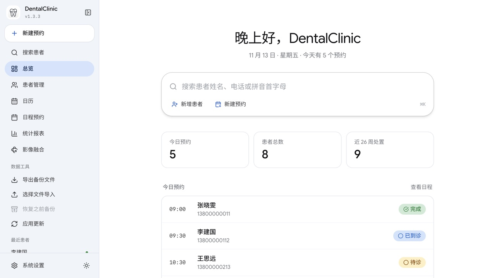
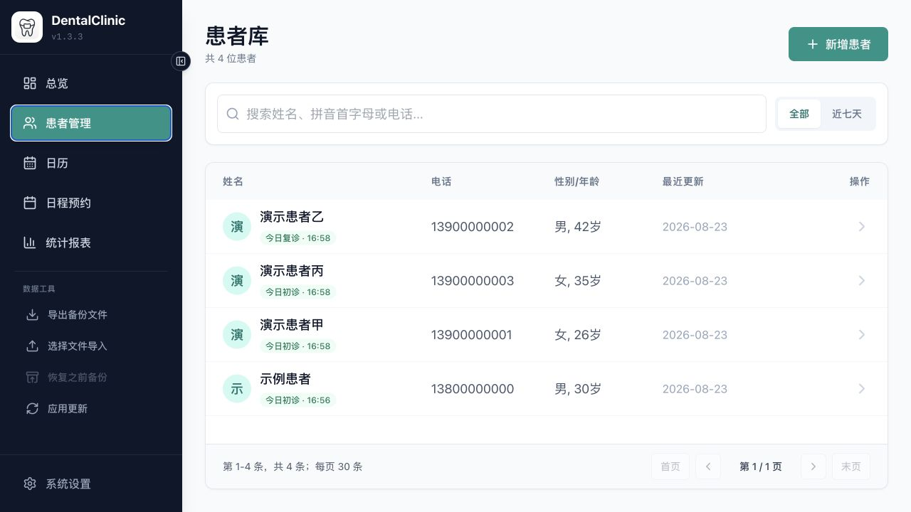
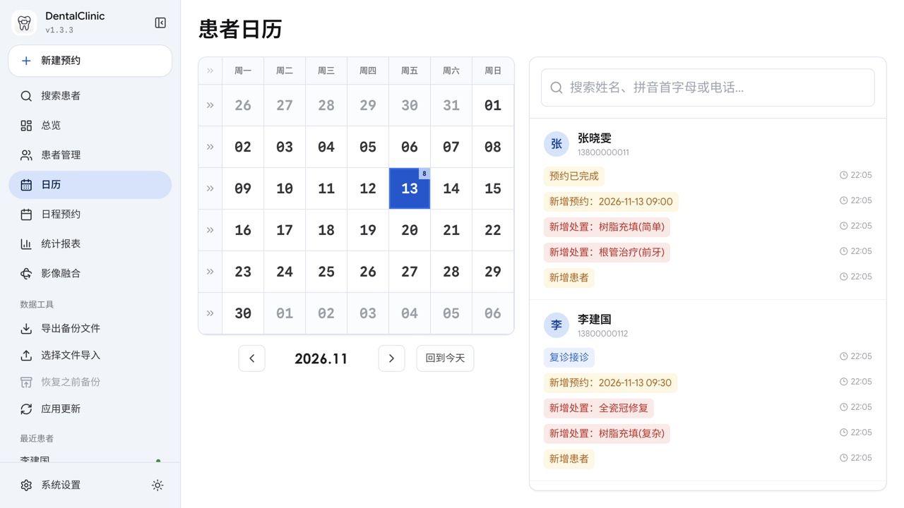
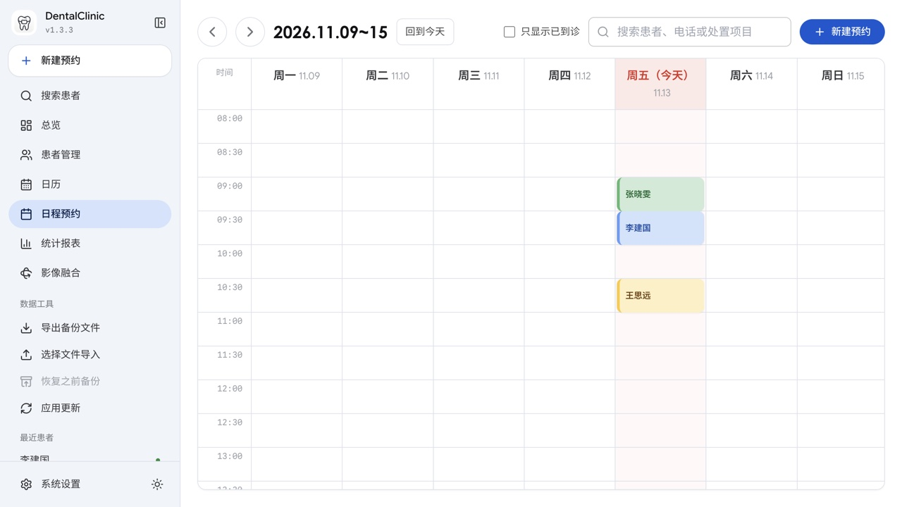
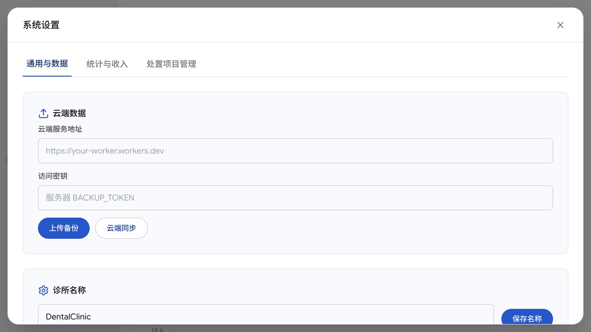
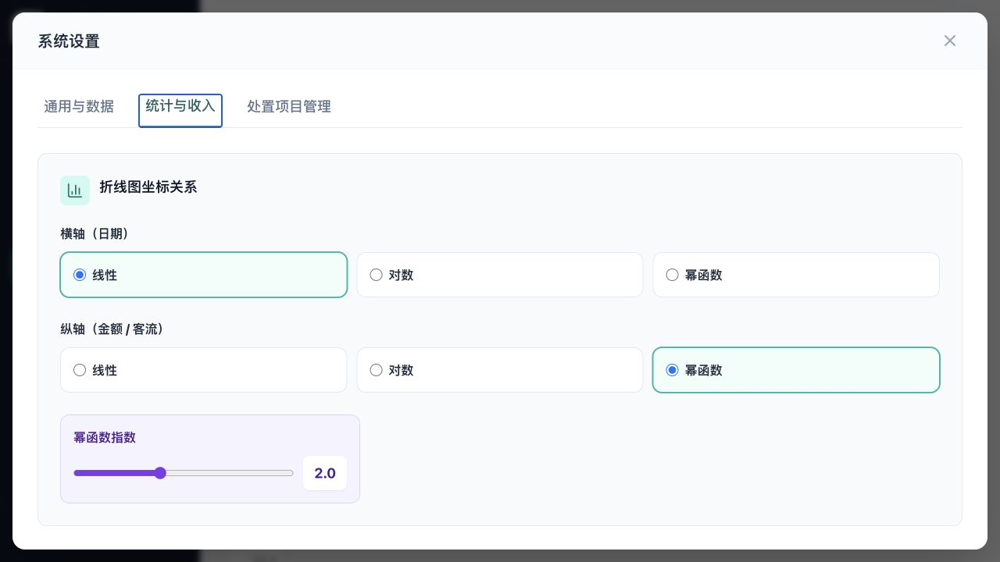

<p align="center">
  
</p>

<h1 align="center">DentalClinic 口腔诊所管理系统</h1>

<p align="center">
  给小型口腔诊所用的本地桌面应用：患者、接诊、处置、预约、报表、备份，以及口扫与 CBCT 的影像融合
</p>

<p align="center">
  <strong>当前版本：v1.4.0</strong> · AGPL-3.0-only ·
  <a href="https://github.com/A2XDEM0/fkDental/releases/latest">下载安装包</a>
</p>



DentalClinic 的数据保存在本机，日常使用不需要注册账号，也不依赖网络。安装包叫 **DentalSystem**，应用内默认显示 **DentalClinic**，诊所名称可以在设置里改成自己的。

> [!IMPORTANT]
> 安装版把业务数据存在 Electron 用户数据目录下的 SQLite 里，敏感内容通过系统安全存储加密。`npm run dev` 启动的是独立的浏览器预览环境，用的是浏览器本地存储，两边的数据不会自动互通。

## 目录

- [v1.4.0 更新了什么](#v140-更新了什么)
- [下载与安装](#下载与安装)
- [第一次使用](#第一次使用)
- [功能](#功能)
- [系统设置](#系统设置)
- [备份、迁移与恢复](#备份迁移与恢复)
- [可选的云端备份](#可选的云端备份)
- [开发与构建](#开发与构建)
- [数据安全](#数据安全)
- [贡献者与致谢](#贡献者与致谢)
- [许可](#许可)

## v1.4.0 更新了什么

- **影像融合**：新增口内扫描模型与 CBCT 的配准工作台，见[影像融合](#影像融合)。
- **新界面**：浅色侧栏、带问候语和患者搜索的总览页，支持浅色和深色两套主题，见[界面与主题](#界面与主题)。
- **macOS 窗口**：隐藏系统标题栏，红绿灯嵌进侧栏左上角。
- **仓库地址**：仓库迁到了 `A2XDEM0/fkDental`，应用内的“应用更新”改为检查新地址。

患者、预约、处置、报表和备份的数据结构没有变化，从 v1.3.x 覆盖安装即可。

## 下载与安装

安装包在 [GitHub Releases](https://github.com/A2XDEM0/fkDental/releases) 下载。

| 平台 | v1.4.0 安装包 | 安装方法 |
| --- | --- | --- |
| Windows 10/11 64 位 | `DentalSystem.Setup.1.4.0.exe` | 双击安装程序，从开始菜单启动 |
| macOS Apple Silicon | `DentalSystem-1.4.0-arm64.dmg` | 打开 DMG，拖入“应用程序” |

v1.4.0 没有提供 Intel Mac 和 Linux 的预编译包。这两个平台可以按[开发与构建](#开发与构建)自行打包，或者使用 [v1.3.3](https://github.com/A2XDEM0/fkDental/releases/tag/v1.3.3) 的安装包（不含影像融合和新界面）。Electron 桌面安装包不能装到 Android 上。

### macOS 首次打开

安装包没有 Apple Developer ID 签名，也没有公证，第一次打开会被系统拦下：

- macOS 15 及以上：先双击打开一次，再到“系统设置 → 隐私与安全性”底部点 **仍要打开**。
- 更早的系统：在“应用程序”里右键 DentalSystem，选“打开”，再在确认窗口里继续。

### 升级与卸载

- 升级前先导出一份 JSON 备份，退出 DentalSystem 后再运行新版本安装包。
- 覆盖安装默认保留用户数据；升级后仍建议核对患者、预约和处置数量。
- Windows 卸载请走“设置 → 应用 → 已安装的应用”，卸载器默认保留本地数据。
- Windows 安装目录里有 `resources/maintenance/DentalSystem-Uninstall-Helper.cmd`。其中的 `D` 选项会删除数据且不可恢复，使用前必须先导出备份。

## 第一次使用

建议按这个顺序做一遍初始化：

1. 打开侧栏底部的 **系统设置**，在“通用与数据”里填写诊所名称。
2. 进入“处置项目管理”，核对分类、项目名称和默认价格。
3. 新增一位测试患者，试一遍初诊、复诊、预约和处置录入。
4. 看一眼统计报表是否符合诊所的查看习惯。
5. 删除测试数据，在侧栏点 **导出备份文件**，保存第一份 JSON 备份。

## 功能

### 患者管理

患者库支持按姓名、电话、全拼和拼音首字母搜索，可以在“全部 / 近七天”之间切换。



- 新增、编辑和删除患者档案，区分初诊与复诊，列表里显示今日接诊状态。
- 遇到相似姓名或相同电话号码会给出提示，减少重复建档。
- 患者详情包含基本信息、处置记录和预约历史。
- 处置可以记录项目、价格、牙位和备注，修改后保留变更日志。

### 接诊与处置

- 新建患者时可以选“仅保存档案”或“保存并接诊”。
- 患者详情里的“标记复诊”会新增一条当天的复诊记录。
- 预约里的计划处置可以在完成预约时转为正式处置，不用重复录入。
- 历史处置保存的是当时的项目名称和成交价，之后修改项目目录不会回写历史记录。

### 患者日历

日历按月汇总建档、初诊、复诊、预约和处置活动。日期上的角标是当天涉及的患者数，右侧显示所选日期的详细记录。



- 可以按患者姓名、拼音或电话过滤活动，点击活动里的患者直接进入详情。
- 按住 `Command`（macOS）或 `Ctrl`（Windows / Linux）可以叠加选择多个日期。

### 日程预约

周视图以 30 分钟为一格展示预约，同一时段允许多个预约重叠。



- 创建预约时可以设置日期、时间、时长、初复诊类型和计划处置。
- 预约有待到诊、已到诊、已完成和已取消等状态，可以按患者、电话或处置项目搜索。
- 预约可以编辑、取消或永久删除。删除的预约会留下同步标记，避免旧设备重新上传后把它带回来。

### 统计报表

报表页是两张带填色的折线图：收入按自然周汇总，客流保留每日粒度。两张图底部都有可以拖动的横向滚动条，默认停在最新数据。


收入图的口径：

- 每条处置记录的价格都计入总收入。
- 日期有效且在图表范围内的处置按自然周（周一至周日）汇总，当前周只统计到今天。
- 日期无效、在未来或超出范围的记录仍留在总收入明细里，但会标成“未纳入折线”。

客流图的口径：

- 只统计 **初诊添加** 和 **复诊添加**。
- 同一患者同一天只算一次；同一天既有初诊又有复诊时算初诊。
- 橙色虚线是平均客流，等于图表日期区间的总客流除以区间内的自然日数，零客流的日子也算在内。

横轴和纵轴可以在线性、对数、幂函数之间切换，见[统计与收入](#统计与收入)。

### 影像融合

把口内扫描的三维模型和 CBCT 对到同一个坐标系里：载入两份数据，点几对对应点，程序自动完成精配准，然后在三维视图和三个切面上核验口扫牙冠与 CBCT 是否贴合。下图是程序合成的演示病例。


- **读取**：未压缩的 DICOM 序列或 NIfTI 体数据，STL / PLY / OBJ 口扫模型。也可以先载入内置的合成演示病例熟悉流程。
- **配准**：在口扫和 CBCT 上按相同顺序点选至少 3 对标记点完成粗配准，再由修剪式 ICP 和牙面阈值自校准完成精配准，计算放在后台线程里。
- **核验**：表面偏差热力图，以及轴位、冠状位、矢状位切面上的口扫轮廓。
- **导出**：配准矩阵 JSON，和已经变换到 DICOM 患者坐标系的 STL。

影像只在本机内存里处理，不写入诊所数据库，也不随云端备份上传。

> [!WARNING]
> 这个模块不是医疗器械，没有做过临床验证。配准结果只用于辅助阅片，用于种植规划、导板设计等临床决策之前，必须由医生逐牙核验。

方法、用到的开源项目、自测结果和已知局限写在 [docs/imaging-fusion.md](docs/imaging-fusion.md)。

### 界面与主题

- **深浅色**：侧栏底部右侧的按钮在浅色和深色之间切换；没有手动切换过时，取启动时的系统外观。主题是本机的显示偏好，不写入诊所数据，也不参与云端同步。
- **快速找人**：总览页的搜索框可以按姓名、电话或拼音首字母查找患者。在其他页面按 `⌘K`（Windows / Linux 为 `Ctrl K`）会跳到这里；有弹窗打开或患者资料正在编辑时不会跳转，以免丢失没保存的内容。
- **侧栏**：可以收起，收起后各项操作以图标按钮保留，悬停时显示说明。
- **macOS 窗口**：不显示系统标题栏，红绿灯嵌在侧栏左上角；侧栏顶部和主区域最上方的窄边可以拖动窗口。
- **字体**：Google Sans Flex、Noto Sans SC 和 Google Sans Code 随应用打包，不需要联网加载。三者均为 SIL Open Font License 1.1，许可文本在 `public/font-licenses/`。

### 侧栏数据工具

四个常用的维护操作固定在侧栏的“数据工具”区域，不用进设置页。

| 按钮 | 用途 | 注意事项 |
| --- | --- | --- |
| 导出备份文件 | 把当前完整数据导出为 JSON | 不修改本机数据 |
| 选择文件导入 | 校验备份并显示新增、覆盖、移除的差异 | 确认后会整体覆盖本机主数据 |
| 恢复之前备份 | 恢复最近一次导入前自动保存的备份 | 没有可用备份时按钮禁用 |
| 应用更新 | 检查新版本，有新版时打开 Release 页面 | 普通的结果提示 3 秒后自动消失 |

## 系统设置

点击侧栏底部的 **系统设置**，弹窗里有三个页签。

### 通用与数据



**诊所名称**：填写后点 **保存名称**，侧栏标题和之后导出的备份都会使用新名称。

**云端数据**：

1. **云端服务地址**：填 Worker 的根地址，例如 `https://your-worker.workers.dev`，末尾不用加 `/backup` 或 `/sync`。
2. **访问密钥**：填与服务器 `BACKUP_TOKEN` 完全相同的密钥。
3. **上传备份**：把当前完整快照加密后上传，云端保留历史版本。
4. **云端同步**：拉取云端最新快照，覆盖本机数据。

点“上传备份”或“云端同步”时，应用会校验并保存当前的地址和密钥。

> [!WARNING]
> 云端同步会覆盖本机数据，同步前请先用侧栏的“导出备份文件”留一份独立副本。访问密钥同时用于鉴权和解密，丢了就无法恢复已有的云端密文。

### 统计与收入

坐标关系的设置改完立即生效并保存在本机，收入图和客流图共用同一组设置。



| 坐标关系 | 显示效果 | 适合场景 |
| --- | --- | --- |
| 线性 | 日期间距均匀，数值按原始比例 | 日常查看，默认选项 |
| 对数 | 压缩较大数值或较远日期之间的视觉差距，零值仍能显示 | 金额或客流跨度很大 |
| 幂函数 | 按指数强化或压缩差距 | 想突出峰值，或调整日期点的间距 |

任一坐标轴选了幂函数后，会出现 **幂函数指数** 滑杆：范围 `0.1–5.0`，步长 `0.1`，默认 `2.0`，横轴和纵轴共用同一个指数。这些选项只改变图上的映射方式，不会修改收入、客流或日期的原始数据。

页签下方的 **总收入明细** 是只读列表，显示处置收费的条数与总收入，以及每条记录的日期、患者、电话、处置项目和金额，按日期和创建时间从新到旧排列。没有进入折线图范围的记录会带标记，所以总收入可能和折线图当前可见区间的合计不一样。


### 处置项目管理


1. 在顶部输入分类名，点 **添加分类**。
2. 在分类右侧点 **添加项目**，填写项目名称和默认价格。
3. 点项目右侧的铅笔修改名称或价格，用绿色对勾确认。
4. 点项目右侧的 `×` 删除项目，点分类右侧的垃圾桶删除整个分类。
5. 全部调整完后，点 **保存所有更改**。

> [!IMPORTANT]
> 分类和项目的增删改先存在弹窗的临时状态里，没点“保存所有更改”就关闭设置，修改不会写入。目录只影响之后的处置和预约计划的默认项目与价格，不会改动历史处置。

## 备份、迁移与恢复

**日常备份**：点侧栏的 **导出备份文件**，把生成的 `dental_clinic_backup_YYYY-MM-DD.json` 存到安全的位置，并定期复制一份到另一块磁盘或受控的加密存储。

**换机或导入**：

1. 在新设备上安装相同或更高的版本。
2. 点侧栏的 **选择文件导入**。
3. 查看患者、预约、处置和目录的新增 / 覆盖 / 移除预览。
4. 确认无误后执行覆盖导入。

确认导入之前，应用会自动保存一份“导入前备份”。需要回退时点 **恢复之前备份**；恢复同样会覆盖当前主数据，所以操作前仍建议另外导出一份 JSON。

## 可选的云端备份

DentalClinic 可以接入 Cloudflare Worker + R2。数据在应用端用访问密钥加密，Worker 和 R2 里存的是密文。

```text
开始工作：云端同步 → 核对数据 → 开始录入
结束工作：导出本地 JSON → 上传备份
```

云端功能是完整快照同步，不是多人实时协作。多台设备轮流使用时，后一台开始工作前必须先同步，前一台结束工作后必须先上传。

Worker、R2、密钥的配置和故障排查见 [docs/cloud-backup.md](docs/cloud-backup.md)。

## 开发与构建

技术栈是 Electron + React 19 + Vite + Tailwind CSS，影像部分用到 three.js、three-mesh-bvh 和 dicom-parser。需要 Node.js 22.18 或更高版本（测试直接运行 TypeScript 文件）。

```bash
npm install
npm run dev        # 浏览器预览，http://localhost:3000
npm run electron   # Electron 开发环境
npm run build      # 前端生产构建
```

检查与测试：

```bash
npx tsc --noEmit
node --test tests/*.test.ts
```

打包安装包：

```bash
npm run package               # 交互式选择平台
npm run package:windows
npm run package:macos         # Apple Silicon
npm run package:macos:intel
npm run package:linux
```

各平台的安装包应当在对应平台或支持交叉构建的环境里生成，产物输出到 `release/`。

目录结构：

| 路径 | 内容 |
| --- | --- |
| `App.tsx`、`pages/`、`modals/`、`components/` | 界面：应用外壳与侧栏、各页面、弹窗、通用组件 |
| `features/` | 按功能划分的模块：`imaging`（影像融合）、`reports`、`tooth`（牙位图）、`treatment` 等 |
| `services/` | 数据读写、迁移和存储适配（SQLite / 浏览器本地存储） |
| `electron-main.js`、`preload.cjs` | Electron 主进程与预加载脚本 |
| `theme.css`、`tailwind.config.js` | 配色与主题。Tailwind 色名映射到 `theme.css` 的 CSS 变量，深浅色切换靠变量取值 |
| `cloudflare-worker.js` | 云端备份用的 Worker |
| `tests/` | 影像算法、文件读取和 Worker 的测试 |
| `docs/` | 影像融合与云端备份的说明文档 |

## 数据安全

- 安装版用 SQLite 保存数据，敏感字段通过 Electron `safeStorage` 借助操作系统的安全能力加密。
- 导出的 JSON 包含完整的诊所业务数据，应当作为敏感文件保管。
- 请给操作系统账户设置密码，不要在截图、工单或公开仓库里泄露患者数据和云端密钥。
- 云端同步不能代替独立的离线备份，应定期验证导出的 JSON 能正常导入。

## 贡献者与致谢

- **OpenAI Codex** — 项目作者与维护者
- **我** — 写prompt协助AI

## 许可

版权所有 © 2026 SlxBYR

本项目采用 [GNU Affero General Public License v3.0](LICENSE)（SPDX：`AGPL-3.0-only`）。修改后以网络服务形式提供的版本，也必须依照 AGPL v3 向远程用户提供对应的源代码。
