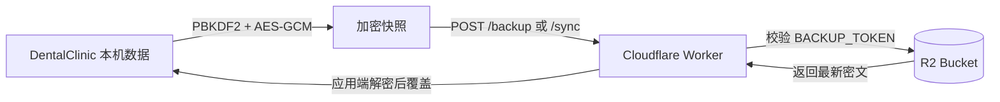

# Cloudflare 加密备份与同步

DentalClinic 的云端功能是可选项。当前实现使用一个 Cloudflare Worker 提供接口、一个 R2 Bucket 保存密文；患者数据会先在应用端加密，再发送到 Worker。

> [!WARNING]
> 云端同步采用“完整快照覆盖”，不是多人实时合并。启用前请先在侧边栏点击“导出备份文件”，保存一份独立 JSON。

## 工作方式



- 应用使用访问密钥派生加密密钥，并通过 AES-GCM 加密完整快照。
- Worker 使用环境机密 `BACKUP_TOKEN` 校验 Bearer Token。
- 设置中的“访问密钥”必须与 `BACKUP_TOKEN` 完全相同；密钥遗失后，已有云端密文无法解密。
- `/backup` 和 `/sync` 都要求鉴权，只有 `/health` 可以匿名访问。

## 准备内容

1. Cloudflare 账号。
2. 一个 R2 Bucket，例如 `dental-backups`。
3. 一个 Worker，例如 `dental-cloud-api`。
4. 一段至少 32 个字符的随机访问密钥。
5. 仓库中的 [`cloudflare-worker.js`](../cloudflare-worker.js)。

Cloudflare 的额度和限制可能调整，请以 [Workers 限制](https://developers.cloudflare.com/workers/platform/limits/) 和 [R2 限制](https://developers.cloudflare.com/r2/platform/limits/) 为准。

## 1. 创建 R2 Bucket

1. 登录 [Cloudflare Dashboard](https://dash.cloudflare.com/)。
2. 进入 **R2 Object Storage**。
3. 点击 **Create bucket**。
4. 输入 Bucket 名称并创建，例如 `dental-backups`。

应用不会直接访问 Bucket，所有读写都经过 Worker。

## 2. 创建并部署 Worker

1. 进入 **Workers & Pages**。
2. 创建一个 Worker，例如 `dental-cloud-api`。
3. 打开代码编辑器，删除示例代码。
4. 复制 [`cloudflare-worker.js`](../cloudflare-worker.js) 的全部内容并部署。

当前 Worker 提供：

| 路径 | 方法 | 用途 |
| --- | --- | --- |
| `/health` | `GET` | 检查 Worker 是否成功部署 |
| `/backup` | `POST` | 创建历史备份并更新最新备份 |
| `/sync` | `POST` | `push` 上传或 `pull` 拉取最新同步快照 |

请求体上限为 10 MiB。

## 3. 绑定 R2 Bucket

1. 打开 Worker 的 **Settings → Bindings**。
2. 添加 **R2 bucket binding**。
3. Variable name 必须填写 `BACKUP_BUCKET`。
4. 选择刚创建的 Bucket，保存并重新部署。

变量名必须与代码中的 `env.BACKUP_BUCKET` 完全一致。

## 4. 添加访问密钥

1. 打开 **Settings → Variables and Secrets**。
2. 添加一个 Secret。
3. Name 填写 `BACKUP_TOKEN`。
4. Value 填写准备好的随机密钥，保存并部署。

不要把真实 Token 写进代码、截图或公开仓库。

## 5. 验证 Worker

访问：

```text
https://你的-worker域名.workers.dev/health
```

看到下面的响应表示 Worker 路由已经运行：

```json
{"ok":true}
```

健康检查只能确认 Worker 已部署。R2 绑定和密钥仍需要通过应用内的一次上传操作验证。

## 6. 在应用中填写配置

打开 **系统设置 → 通用与数据**：

1. “云端服务地址”填写 Worker 根地址，例如 `https://dental-cloud-api.example.workers.dev`。
2. 地址末尾无需添加 `/backup` 或 `/sync`；应用会自动生成接口地址。
3. “访问密钥”填写与 `BACKUP_TOKEN` 相同的值。
4. 点击“上传备份”或“云端同步”时，应用会校验并保存当前配置。

“云端同步”会从云端拉取完整快照并覆盖本机数据，操作前请先导出本地 JSON。

## 7. 第一台与第二台设备

第一台设备已有完整数据时：

1. 从侧边栏导出 JSON。
2. 在设置中点击“上传备份”。
3. 确认界面提示上传成功。

第二台设备接入时：

1. 安装相同或更高版本的 DentalClinic。
2. 填写同一个 Worker 根地址和访问密钥。
3. 若第二台设备已有数据，先导出 JSON。
4. 点击“云端同步”，阅读覆盖确认后继续。
5. 核对患者数、预约和处置记录。

## 日常使用顺序

```text
开始工作：云端同步 → 核对数据 → 开始录入
结束工作：导出本地 JSON → 上传备份
```

不要让两台设备分别离线编辑后再同时上传；最后一次上传的完整快照会成为云端最新版本。

## 常见问题

| 现象 | 常见原因 | 处理方法 |
| --- | --- | --- |
| `Unauthorized` / 401 | 应用密钥与 `BACKUP_TOKEN` 不一致 | 重新复制同一个密钥，检查空格和大小写 |
| `Storage operation failed` / 500 | 未绑定 R2 或绑定名错误 | 检查 `BACKUP_BUCKET` 并重新部署 |
| `No cloud data` / 404 | 尚未上传或连接了错误 Worker | 先在主设备点击“上传备份” |
| `/health` 返回 404 | Worker 代码未更新或域名错误 | 重新部署仓库中的 Worker 代码 |
| 请求过大 / 413 | 加密快照超过 10 MiB | 先导出本地备份，再排查异常超大数据 |
| 无法解密 | 密钥不一致或密文损坏 | 不要继续覆盖，改用正确密钥或本地 JSON |
| CORS / 网络失败 | URL、部署或网络异常 | 先检查 `/health`，再查看 Worker 日志 |

无论是否使用云端功能，都应定期保存独立的离线 JSON 备份。
