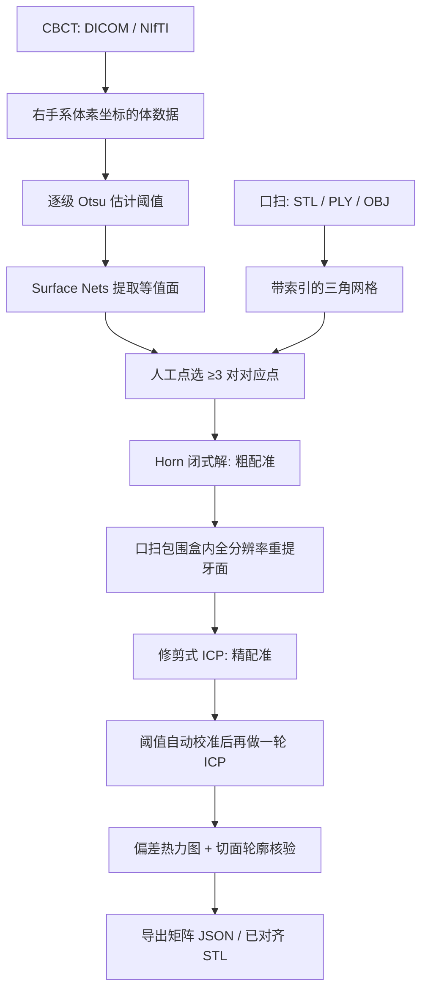

# 影像融合：口扫三维模型 × CBCT

本文说明 DentalClinic 里“影像融合”模块的设计：为什么要把口内扫描（IOS）和 CBCT 对到同一坐标系、当前版本怎么做、用了哪些开源项目、精度大概在什么水平、还缺什么。

面向两类读者：接手这个项目的开发者，以及想知道这个功能能信到什么程度的医生。

> [!WARNING]
> 这个模块不是医疗器械，没有做过临床验证。配准结果只用于辅助阅片，任何用于种植规划、导板设计等临床决策的场景，都必须由医生在三个切面上逐牙核验口扫轮廓与 CBCT 牙冠是否贴合。

## 1. 项目现状与对影像功能的约束

| 现状 | 对影像功能意味着什么 |
| --- | --- |
| 纯前端桌面应用：Electron + React 19 + Vite + Tailwind，没有后端服务 | 读取、重建、配准都必须在渲染进程（浏览器环境）里完成，或者以后另起本地旁路进程 |
| 业务数据是一份 `ClinicData` 快照，存在 SQLite（kv + 规范化表）里，整体读写 | 一套 CBCT 就有几百 MB，不能塞进这份快照 |
| 云端功能是“完整快照加密后上传”，Worker 拒绝超过 10 MiB 的请求 | 影像数据不能、也不应该进入云同步；即使以后要保存配准结果，也只能保存“文件引用 + 矩阵”这类小数据 |
| 渲染进程开启 `contextIsolation`、关闭 `nodeIntegration`，preload 只暴露 SQLite 接口 | 渲染进程没有 Node 文件系统能力，读文件走 `<input type="file">`（含 `webkitdirectory` 选文件夹）和拖拽 |
| 项目许可为 AGPL-3.0-only | 引入的库必须与 AGPL v3 兼容。本方案集成的库都是 MIT 许可，评估过的候选是 MIT / BSD / Apache-2.0，均兼容 |
| 首屏包体约 380 kB | three.js 等影像依赖体积较大，所以影像页面用 `React.lazy` 按需加载，不影响日常启动 |

因此当前版本的定位是：**一个独立的本机工作台**。影像只在内存里处理，不写数据库、不上传；输出是可以带走的配准矩阵和已对齐的 STL。把结果挂到患者档案属于后续工作（见第 7 节）。

## 2. 为什么要融合，难在哪

| | 口内扫描（IOS） | CBCT |
| --- | --- | --- |
| 数据形态 | 表面三角网格，STL / PLY / OBJ | 体数据，DICOM 序列 |
| 能看到什么 | 牙冠、牙龈的表面 | 牙冠、牙根、颌骨、神经管、上颌窦 |
| 精度量级 | 几十微米 | 体素 0.1–0.4 mm |
| 看不到什么 | 牙根和骨 | 软组织表面（牙龈在 CBCT 上和唇颊舌分不开） |
| 坐标系 | 扫描仪自定，每次都不一样 | DICOM 患者坐标系 (LPS) |

两者合在一起，才能同时得到“精确的牙冠与牙龈表面”和“牙根与骨的位置”，这是种植规划、导板设计、正畸牙根控制等工作的基础数据。

难点主要有五个：

1. **坐标系互不相关。** 口扫和 CBCT 之间差一个未知的刚体变换（3 个旋转 + 3 个平移），需要从数据本身求出来。
2. **只有牙冠表面是真正重合的。** 口扫里有牙龈，CBCT 等值面里有牙根和骨，这些都没有对应面，配准时必须剔除，否则会把结果带偏。
3. **CBCT 灰度不是标定过的 HU。** 不同机型、不同视野下数值差异很大，不能写死“牙釉质 = 多少 HU”，阈值要从直方图估计并允许人工调整。
4. **阈值决定表面位置。** 牙冠边缘在 CBCT 上是一段灰度过渡带，阈值取高，等值面整体内缩；取低，整体外扩。这会直接变成配准的系统误差。
5. **金属伪影。** 金属冠、种植体、正畸托槽会在 CBCT 上产生条状伪影，破坏附近牙冠的等值面。当前版本没有专门处理。

## 3. 本项目采用的方法

整体是经典的“标记点粗配准 + 表面 ICP 精配准”，全部在浏览器里完成，不依赖 Python 或 GPU。



代码都在 `features/imaging/` 下，页面是 `pages/ImagingFusion.tsx`。

### 3.1 读取 CBCT

| 步骤 | 文件 | 说明 |
| --- | --- | --- |
| DICOM 序列 | `io/dicomSeries.ts` | 用 dicom-parser 解析。按 `SeriesInstanceUID` + 行列数分组，自动选层数最多的序列；按层位置在“行方向 × 列方向”法向上的投影排序，层间距取相邻层距的中位数，不均匀时给出警告；按 `RescaleSlope/Intercept` 换算后存成 `Int16Array`。分两遍读文件，内存峰值约等于一份体数据。多帧（Enhanced）DICOM 做了基本支持 |
| NIfTI | `io/nifti.ts` | 读 NIfTI-1 的 `.nii` / `.nii.gz`，按 sform / qform 取方向，RAS 转 LPS |
| 坐标约定 | `types.ts` | 体素局部坐标以毫米计：`x = i·sx, y = j·sy, z = k·sz`，另存一个 `toPatient` 矩阵把它变到 DICOM 患者坐标系 (LPS) |

有两点是刻意保证的：

- **体素坐标系保持右手系。** DICOM 按切片位置沿法向升序排层（缺少 ImagePositionPatient 时只能按 InstanceNumber 排，方向无法确认，见 5.3）；NIfTI 遇到左手系存储时翻转 i 轴。否则体数据会被左右镜像，而镜像后的牙列无论如何都无法和真实口扫刚性对齐。
- **只读未压缩传输语法**（Implicit / Explicit VR Little Endian、Explicit VR Big Endian）。遇到 JPEG Lossless、JPEG 2000 等压缩数据会明确报错，并提示在 CBCT 工作站导出未压缩数据，或先用 dcm2niix 转成 NIfTI。

### 3.2 读取口扫

`io/meshFile.ts` 用 three.js 自带的 STLLoader / PLYLoader / OBJLoader 解析，合并重复顶点后得到带索引的网格（PLY 的顶点颜色会保留）。单位按毫米处理，模型尺寸异常偏小时界面会提示。

### 3.3 阈值与等值面

| 步骤 | 文件 | 说明 |
| --- | --- | --- |
| 阈值估计 | `math/volume.ts` 的 `suggestThresholds` | 对直方图做三级 Otsu：空气｜软组织 → 软组织｜骨 → 骨｜牙，后两级分别作为“骨”“牙”预设。界面上可用滑块随时调整 |
| 降采样 | `math/volume.ts` | 全体积显示用的等值面按块平均降采样，把网格规模控制在可交互范围内；小体积不降采样时做一次 1-2-1 平滑降噪 |
| 等值面 | `math/surfaceNets.ts` | Naive Surface Nets，直接输出带索引、法向朝外的网格，顶点位置按边上的线性插值取平均，达到亚体素精度；之后去掉噪声产生的孤立小碎片 |

### 3.4 粗配准：标记点 + Horn 闭式解

在口扫视口和 CBCT 视口上按相同顺序各点至少 3 个对应位置（最多 8 对），`math/rigid.ts` 的 `fitRigid` 用 Horn 四元数法求最小二乘刚体变换。这个解法不含缩放，也不会产生镜像。

点选建议：选牙尖、切缘这类在两种数据上都清晰的位置，并让它们分布在牙弓两侧和前牙区。三个点挤在一侧时，另一侧的误差会被放大。界面会显示每一对点的残差，残差很大通常意味着两侧点选顺序不一致或点错了牙位。

粗配准的目标只是“大致到位”（1–2 mm 以内即可），精度交给下一步。

### 3.5 精配准：修剪式 ICP

粗配准之后，程序只在**口扫包围盒附近**（外扩几毫米）以全分辨率重新提取 CBCT 牙面，作为 ICP 的目标面。这样既保住了牙冠处的精度，又避免对整个体积做全分辨率重建。

`math/icp.ts` 的 `runIcp` 每一轮做四件事：

1. 把口扫采样点（约 1.5 万个顶点）变换到 CBCT 坐标系，用 three-mesh-bvh 查询目标面上的最近点（`math/bvhQuery.ts`）。
2. **剔除没有对应面的点。** 两个条件：口扫法向与目标面法向要大致同向；距离不能超过稳健阈值（3 倍 MAD 估计的标准差，并设有下限，防止迭代后期把真实牙面也剪掉）。牙龈、被唇颊遮挡的区域就是这样被排除的。首轮会自动判断两套网格的法向约定是否相反（比如 STL 面片朝内）。
3. 求本轮位姿增量：前 4 轮用点到点（稳），之后切换到点到面（收敛快，允许沿牙面滑动）。
4. 收紧搜索半径；位姿连续两轮几乎不变即判定收敛。

### 3.6 阈值自动校准

第一轮 ICP 之后，口扫牙冠表面已经基本贴在 CBCT 的牙冠边缘上。此时沿口扫表面法向在 CBCT 上取灰度剖面，按“半高”原则估计牙冠边缘实际对应的灰度值，再用这个灰度重新提取牙面、做第二轮 ICP（`math/calibrate.ts`）。目的是消除第 2 节提到的“阈值取高整体内缩、取低整体外扩”带来的系统偏差，让结果不再依赖用户把滑块拖到哪里。

具体做法：对每个已经贴合（距 CBCT 牙面不超过一个体素）的口扫采样点，沿法向向内、向外各取 1.5–3 个体素处的灰度，内侧取最大值、外侧取最小值，两者的平均就是这个点的边缘灰度；内外反差不足的点（邻牙接触区、牙龈覆盖区）不参与；最后取所有点的中位数。有效点少于 200 个时放弃校准，保留第一轮的结果。

### 3.7 核验

配准不能只看一个数字。界面提供两种互补的核验方式：

- **切面轮廓。** 把口扫网格与轴位、冠状位、矢状位切面的交线画在灰度图上（`view/contours.ts`、`view/SliceView.tsx`）。轮廓应当沿着牙冠的亮边走。这是判断配准对不对的主要依据。
- **表面偏差热力图。** 逐顶点计算口扫到 CBCT 牙面的距离，在口扫上按 0–1 mm 的单色色标着色；找不到对应面的区域（牙龈等）显示为灰蓝色。

面板上的统计（中位数、RMS、95% 分位、≤0.2 mm 的占比）只覆盖被判定为“有对应面”的采样点。**数值小不等于配准一定正确**：如果粗配准把口扫错位了一颗牙，ICP 也可能在错误的位置上收敛到一个看起来不错的数字，这时切面轮廓和标记点残差会暴露问题。

### 3.8 导出

| 导出物 | 内容 |
| --- | --- |
| 配准矩阵 JSON | 口扫 → CBCT 体素毫米坐标、口扫 → DICOM 患者坐标 (LPS) 两个 4×4 矩阵（按行排列，单位毫米），以及标记点、表面拟合统计 |
| 配准后 STL | 顶点已变换到 CBCT 的 DICOM 患者坐标系，可在支持按 DICOM 坐标叠加的规划软件里与同一套 CBCT 直接重合 |

### 3.9 其他实现要点

- **重计算在 Web Worker 里**（`worker/fusionWorker.ts`）：等值面提取、BVH 构建、ICP、逐顶点距离都不占用界面线程。主线程只做文件解析和子体积裁剪。
- **三维视口**（`view/Viewport3D.ts`）是对 three.js 的薄封装，按需渲染；口扫网格用 three-mesh-bvh 加速点选。
- **演示病例**（`demo/phantom.ts`）是程序合成的上下颌牙列 CBCT 和一份下颌口扫，口扫被放到任意坐标系里，真值变换已知，既用于演示流程，也用于自动化测试里定量检验配准误差。不含任何真实患者数据。
- 影像页面打开后保持挂载，切到其他页面再回来，已载入的数据和配准结果还在；关闭应用即释放。

## 4. 可行的开源项目

下表的许可信息核实于 2026-11，来源见各项目链接；标注“需自行核对”的是没能确认的部分。

### 4.1 已集成

| 项目 | 用途 | 许可 |
| --- | --- | --- |
| [three.js](https://github.com/mrdoob/three.js) | 三维渲染；STL / PLY / OBJ 解析；顶点合并 | MIT |
| [three-mesh-bvh](https://github.com/gkjohnson/three-mesh-bvh) | 网格 BVH：ICP 的最近表面点查询、点选射线加速 | MIT |
| [dicom-parser](https://github.com/cornerstonejs/dicomParser) | DICOM Part 10 解析 | MIT |

Surface Nets、Horn 配准、ICP、NIfTI 读取、STL 写出是项目内自己实现的，没有引入额外依赖。

### 4.2 评估过、没有作为内嵌主方案

| 项目 | 能做什么 | 许可 | 没选它的原因 | 位置 |
| --- | --- | --- | --- | --- |
| [Cornerstone3D](https://github.com/cornerstonejs/cornerstone3D) | 完整的医学影像渲染与工具栈（MPR、体渲染、测量、压缩 DICOM 解码） | MIT | 需要配套 Web Worker、WASM 解码器和 vtk.js，对“一个配准工作台”来说偏重；网格点选和配准交互仍要自己写 | 需要测量工具或压缩传输语法时的首选升级方向 |
| [vtk.js](https://github.com/Kitware/vtk-js) | 体渲染、MPR、网格可在同一场景 | BSD-3-Clause | API 冗长，不含 DICOM 读取 | 以后要做真正的体渲染时再考虑 |
| [NiiVue](https://github.com/niivue/niivue) | 体数据与网格同屏显示，上手很快 | BSD-2-Clause | 单画布、交互可定制性有限，不适合做逐点标记和配准流程 | 仅作参考 |
| [ITK-Wasm](https://github.com/InsightSoftwareConsortium/ITK-Wasm)（`@itk-wasm/dicom`） | 基于 GDCM 的 DICOM 序列读取，支持各种压缩传输语法 | Apache-2.0 | WASM 模块默认从 CDN 取，离线诊所环境需要改成本地打包，体积也大 | 推荐作为下一阶段解决压缩 DICOM 的方案 |
| [OHIF Viewer](https://github.com/OHIF/Viewers) | 基于 Cornerstone3D 的完整阅片应用 | MIT | 是一个独立应用，不是可嵌入的组件 | 仅作参考 |

### 4.3 离线 / 旁路自动化

这些工具不在应用里运行，但可以和当前功能衔接，或者作为下一阶段自动化的基础。

| 项目 | 用途 | 许可 | 位置 |
| --- | --- | --- | --- |
| [dcm2niix](https://github.com/rordenlab/dcm2niix) | 把压缩 DICOM 转成 NIfTI，再导入本应用 | 主体为 BSD 风格许可，随附的第三方组件各有许可；作者声明仅供研究用途 | **现在就可以用**，是压缩 DICOM 的变通办法 |
| [3D Slicer](https://github.com/Slicer/Slicer) | 通用医学影像平台，可做人工配准、分割、格式转换 | 3D Slicer License（BSD 风格） | 人工复核与对照的参照工具 |
| [DentalSegmentator](https://github.com/gaudot/SlicerDentalSegmentator) | 3D Slicer 扩展，nnU-Net 模型，自动分割上颌与上部颅骨、下颌、上牙、下牙、下颌神经管 | 代码 Apache-2.0；[预训练权重](https://zenodo.org/records/10829675) CC BY 4.0 | 推荐作为下一阶段：先分割出牙齿，再配准，可以免去阈值问题 |
| [nnU-Net](https://github.com/MIC-DKFZ/nnUNet) | DentalSegmentator 所用的分割框架 | Apache-2.0 | 同上 |
| [TotalSegmentator](https://github.com/wasserth/TotalSegmentator) | 通用 CT 分割；`teeth` 任务按 FDI 牙位逐牙分割，`craniofacial_structures` 任务分割下颌、上下牙列等 | 代码 Apache-2.0；README 把这两个任务列在“可任意使用”一类，另有部分任务需要单独申请许可 | 逐牙分割的候选，使用前请再核对其 README 的许可说明 |
| [SlicerAutomatedDentalTools](https://github.com/DCBIA-OrthoLab/SlicerAutomatedDentalTools) | 3D Slicer 扩展，其中 AReg 模块做 CBCT 与口扫的自动配准，另有自动定向、标志点识别等 | 仓库 LICENSE 为 3D Slicer License（BSD 风格）；各模块下载的模型权重许可需自行核对 | 仅作参考。2024 年的维护记录提到 AReg 依赖特定版本的 itk-elastix，口扫配准是否已并入正式版也未能确认 |
| [Open3D](https://github.com/isl-org/Open3D) | 点云 / 网格处理：FPFH 特征 + RANSAC 全局配准，各种 ICP | MIT | 推荐作为下一阶段：做免标记点的全局粗配准 |
| [MeshSegNet](https://github.com/Tai-Hsien/MeshSegNet) | 口扫网格的牙齿分割 | MIT | 推荐作为下一阶段：把口扫里的牙龈去掉，只用牙冠配准 |
| [Teeth3DS](https://github.com/abenhamadou/3DTeethSeg22_challenge) | 口扫牙齿分割的公开数据集（3DTeethSeg'22） | **CC BY-NC-ND 4.0，仅限非商业研究与教学**，商用需另行授权 | 仅作参考；不能直接用于商业产品的模型训练 |
| [ITKThinShellDemons](https://github.com/InsightSoftwareConsortium/ITKThinShellDemons) | 网格间的非刚性配准，作者用它在 ICP 之后进一步细化口扫与 CBCT 牙面 | Apache-2.0 | 仅作参考；临床融合通常只需要刚性配准 |
| [SlicerCBCTToothSegmentation](https://github.com/KitwareMedical/SlicerCBCTToothSegmentation) | 3D Slicer 扩展，CBCT 单牙分割 | Apache-2.0；模型权重许可需自行核对 | 仅作参考 |
| [MeshSegNet-DentalArchAligner](https://github.com/0x11111111/MeshSegNet-DentalArchAligner) | 把口扫分割、牙弓检测、CBCT 重建、ICP 串成流程的社区项目 | 许可需自行核对；其 CBCT 配准部分以 Windows 二进制形式分发 | 仅作参考 |

关于许可兼容性：MIT、BSD、Apache-2.0 的代码都可以并入 AGPL-3.0 项目。模型权重和数据集的许可与代码是分开的，CC BY-NC 一类的非商业条款尤其要留意。

## 5. 精度与边界

### 5.1 文献里的量级

| 来源 | 方法 | 报告的误差 |
| --- | --- | --- |
| [Bioengineering 2023](https://www.ncbi.nlm.nih.gov/pmc/articles/PMC10669060/) | 基于三维分割的 CBCT–口扫自动配准 | 对应点距离 0.234 ± 0.019 mm |
| [Jang 等，arXiv 2112.01784](https://arxiv.org/abs/2112.01784v2) | 两种数据分别做单牙分割与牙位识别，再逐牙 ICP | 标志点误差 0.11 mm，表面距离 0.30 mm |
| [BMC Oral Health 2024](https://doaj.org/article/ebe4d1bf68864210b19beb2c6d6e6562) | 牙冠–牙根融合，考察体素大小和阈值 | 融合后 RMS 0.036–0.095 mm；结论是体素大小和阈值设置显著影响 CBCT 重建与融合精度 |

这些数字来自各自不同的数据和评价口径，不能直接相互比较，也没有找到汇总的荟萃分析。可以得到的大致结论是：基于表面的配准，误差多在 0.2–0.3 mm 量级，上限受 CBCT 体素大小限制；阈值确实会影响结果，这也是 3.6 节那一步存在的原因。

关于金属伪影：本次检索没有找到可以直接引用的定量结论。已有工作专门研究“对金属伪影稳健的分割后再配准”（例如 [Segmentation-based-Registration](https://relatedrepos.com/gh/wlgjs8/Segmentation-based-Registration)，未核实其内容与许可），说明这是公认的问题。

### 5.2 本实现的自测

目前只在程序合成的演示病例（`demo/phantom.ts`）上测过：256 × 256 × 160 体素、0.35 mm 各向同性的上下颌牙列，加一份约 32 万三角面的下颌口扫，口扫被放到任意坐标系里，真值变换已知。下表里的“与真值的偏差”是把口扫顶点分别用求得的矩阵和真值矩阵变换后的 RMS 距离，粗配准的 5 对标记点各加了 ±0.5 mm 的随机扰动。

| 起始牙面阈值 | 只做第一轮 ICP | 校准得到的阈值 | 第二轮 ICP 之后 |
| --- | --- | --- | --- |
| 1984（直方图给出的“牙”预设） | 0.177 mm | 1320 | 0.011 mm |
| 832（“骨”预设） | 0.154 mm | 1318 | 0.010 mm |
| 1345 | 0.016 mm | 1320 | 0.011 mm |
| 2300 | 0.277 mm | 1319 | 0.010 mm |

粗配准之后、ICP 之前的偏差是 0.310 mm。四种起始阈值最后都收敛到同一个牙面灰度和同一个位姿，表面偏差中位数 0.023 mm、RMS 约 0.05 mm，16,030 个采样点里约 8,830 个被判为有对应面（其余是牙龈）。把图像噪声的标准差从默认的 55 加到 250 重跑，结果基本不变（0.011 mm，校准阈值 1321）。`tests/imagingMath.test.ts` 里的全流程测试把“小于 0.05 mm”作为回归门槛。

这些数字说明的是算法在理想数据上没有系统偏差，**不代表临床精度**。合成数据没有金属伪影、运动伪影、口扫拼接误差和软组织形变，牙釉质边缘也比真实 CBCT 干净得多；真实数据上的误差应当参照 5.1 的文献量级来预期，并且还没有用真实病例验证过。

### 5.3 已知局限

| 局限 | 影响 | 变通办法 |
| --- | --- | --- |
| 只读未压缩 DICOM | 部分 CBCT 默认导出 JPEG Lossless / JPEG 2000 时无法直接载入 | 导出时选未压缩，或用 dcm2niix 转 NIfTI |
| 只做刚性配准 | 口扫的全牙弓拼接误差、拍摄间隔内的牙齿移动不会被补偿 | 误差集中在牙弓远端时，可只对关心的区段取标记点 |
| 需要人工点选标记点 | 结果依赖操作者；点错牙位会导致错误收敛 | 看标记点残差和切面轮廓 |
| 没有金属伪影处理 | 金属修复体附近的 CBCT 牙面不可靠 | 标记点避开金属牙；核验时重点看无金属的牙 |
| 没有分割，靠阈值取牙面 | 牙冠与对颌牙咬合接触、或与骨灰度接近时，等值面会粘连 | 调整阈值；拍 CBCT 时让上下牙分开 |
| 体数据整份放在内存 | 特大视野、小体素的 CBCT 可能占用 1 GB 以上内存 | 导出时选较小视野或较大体素 |
| 数据不落盘 | 关闭应用后需要重新载入 | 导出矩阵 JSON 和 STL 留档 |
| DICOM 缺少切片位置时方向不可靠 | 层序只能按 InstanceNumber 排列，体数据可能是镜像的；牙弓近似对称，ICP 仍可能收敛到左右互换的位置并给出很小的偏差 | 界面会在数据卡片和配准面板里提示，导出的 JSON 也带这条警告；先在切面上核对左右，或重新导出带位置信息的序列 |

## 6. 运行测试

```bash
node --test tests/*.test.ts
```

Node 24 自带 TypeScript 类型擦除，不需要额外的测试框架。影像相关的测试有两个文件：

| 文件 | 覆盖内容 |
| --- | --- |
| `tests/imagingMath.test.ts` | 刚体拟合还原已知变换；Surface Nets 在解析球面上的精度、闭合性与法向朝向；碎片剔除；用合成病例跑完“标记点 + ICP”全流程并检查与真值的偏差 |
| `tests/imagingIo.test.ts` | 乱序 DICOM 切片的重排与 HU 换算；压缩传输语法的报错；NIfTI 的 gzip 与左手系翻转；STL 写出再读回 |

为了让这些模块能直接被 Node 加载，`features/imaging` 里 `math/`、`io/`、`demo/`、`worker/` 之间的相对导入带 `.ts` 后缀，这与项目其他部分的写法不同，是有意为之。

## 7. 后续路线

| 方向 | 说明 |
| --- | --- |
| 挂到患者档案 | 在患者记录里保存“影像文件引用 + 文件哈希 + 4×4 矩阵 + 配准统计”。只有这几百字节进入 `ClinicData`，影像本身不进快照、不进云同步；需要递增 `DATA_VERSION` 并写迁移 |
| 影像目录与大文件存储 | 在 Electron 主进程侧管理一个本机影像目录，通过 preload 暴露受限的读写接口，替代每次手动选文件 |
| 免标记点的全局配准 | 以 Python 或 ONNX 旁路进程运行 CBCT 牙齿分割（DentalSegmentator / TotalSegmentator），再用 Open3D 的 FPFH + RANSAC 求初始位姿，ICP 部分沿用现有实现 |
| 逐牙 ICP | 两种数据都分割到单牙之后，逐牙配准并检查一致性，可以发现口扫拼接误差，也更抗金属伪影 |
| 压缩传输语法解码 | 引入 ITK-Wasm 或 Cornerstone 的解码器，本地打包 WASM |
| 手动微调 | 配准后提供平移 / 旋转的小步长微调，并实时刷新切面轮廓 |
| 上颌与双颌 | 当前流程一次配一份口扫；双颌可以各配一次，后续可加入咬合关系 |
